# Agent Deck

A [Tern](https://stencil.so/tern) block that shows every coding agent you have running, as an 8-bit crew. Each session gets its own character that walks while it works, blinks while it waits for you, and shakes when it needs your input. Works for agents on your machine and on remote Coder workspaces.

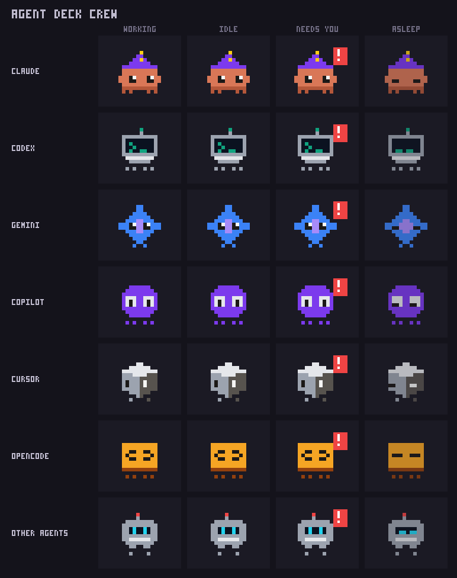

## What it does

Open it with ⌘K → **Sessions**.

- **Every live agent, whichever app runs it.** Claude Code, Codex, Gemini, Copilot, Cursor, opencode and more, running in Superset, herdr, Tern or a plain terminal, each as a tile with its status, task, worktree and branch.
- **Status straight from the agent.** For Claude Code that is its own session status (working, running a command, idle, waiting on you); for other agents it comes from herdr or Superset.
- **Hover to peek.** Hover a tile and a popover shows the bottom of that session's terminal: what it is doing or saying right now.
- **Click to jump in.** A click (or ⏎) opens the live session in a Tern tab, attached to its Superset terminal or herdr pane. Close ends it (press twice).
- **Recent sessions sleep below.** Your recent Claude Code sessions doze in their own tiles; click one to resume it.
- **Every machine at once.** Agents on this Mac and on each of your running Coder workspaces share one view; remote tiles say where they run (`· herdr @ my-workspace`), and Open, Close and `n` act on that machine. Press `m` to narrow the view to one machine. The helpers run there over ssh; nothing needs installing.

### When an agent needs you

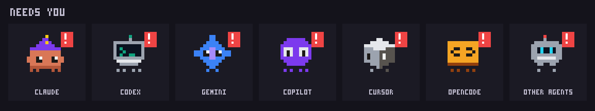

The tile pulses red, a banner names who is waiting, the question it is asking (a permission prompt, a multiple-choice question, a plan to approve) shows on the tile, the block title becomes `Sessions · 1 needs you`, and macOS posts a notification with a sound. Click or ⏎ to answer.

## The crew

Every session keeps its look and name for life (they are picked from the session id). Claude wears one of ten hats; every other agent has its own character in five variants.

### Claude · 10 hats

Merlin, Confetti, Sir Tokens, Queen Context, Zippy, Chef Prompt, Tex, Bjorn, Coach, Pom.

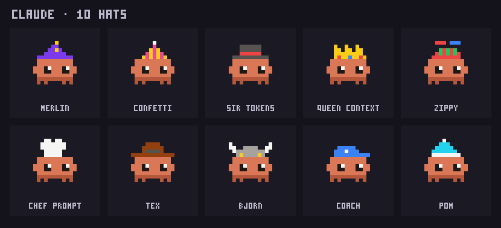

### Codex · terminal-bot

Prompt, Amber, BSOD, Retro, Neo.

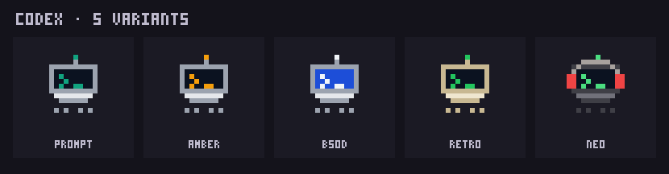

### Gemini · sparkle

Twinkle, Rosé, Lagoon, Gilded, Halo.

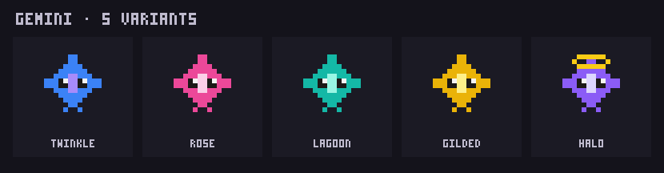

### Copilot · pilot goggles

Maverick, Goose, Iceman, Red Baron, Mint Julep.

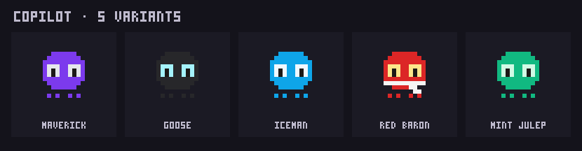

### Cursor · cube

Cubert, Midnight, Goldie, Minty, Rosie.

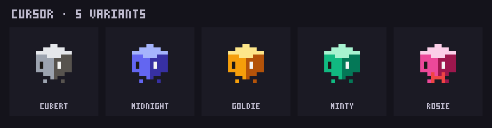

### opencode · brace block

Brace, Lime, Sky, Rosa, Slate.

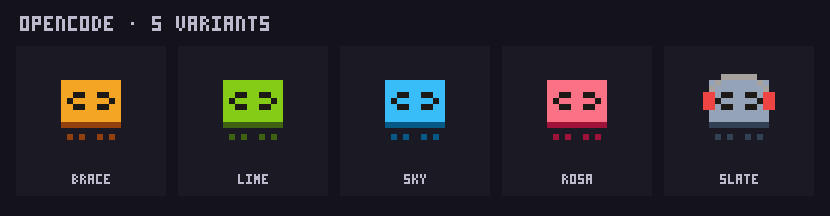

### Any other agent · robot

Amp, Aider, Droid, Goose, Qwen, Kimi, Grok, Crush and anything else: Bolt, Brass, Navi, Sprout, Rusty.

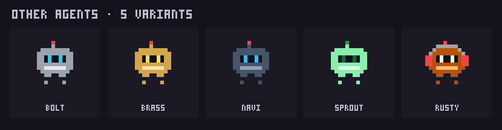

### States

| Working | Idle | Needs you | Asleep |
|---|---|---|---|
| walks, bobs, eyes dart, sparkles | breathes and blinks | shakes with a red `!` | eyes shut, a `z` drifts up |

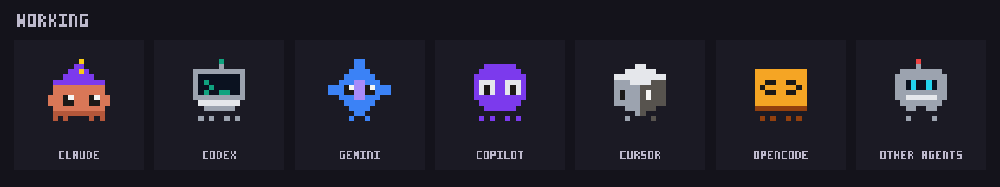
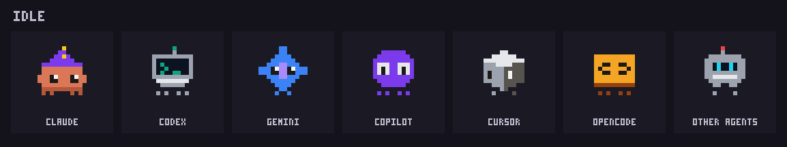
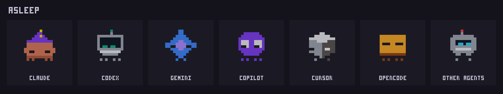

## Install

```sh
tern plugin install github.com/GielVdh/agent-deck
```

The repo is private: you need access to it (ask for an invite), and git must be able to clone it (`gh auth login`, or an ssh key on GitHub).

Or clone it and link it, so edits apply on `tern plugin reload agent-deck`:

```sh
git clone https://github.com/GielVdh/agent-deck ~/tern-plugins/agent-deck
tern plugin link ~/tern-plugins/agent-deck
```

**Needs:** Tern with plugin support, and `python3` (stdlib only) on each machine you look at. Everything else is optional and lights up when present:

| Tool | Used for |
|---|---|
| Claude Code | live status, titles and questions of Claude sessions; recent sessions to resume |
| [herdr](https://herdr.dev) | agents running in herdr panes; attaching to and closing them |
| Superset / Paradev | agents in Superset terminals; attaching to and closing them |
| `coder` (with `coder config-ssh`) | including the agents on your running Coder workspaces |

## Configure

Everything has a default. To change one, copy `config.example.json` to `config.json` next to `plugin.toml` (it is gitignored) and reload:

| Key | Default | Meaning |
|---|---|---|
| `ssh_host` | `"coder.{name}"` | how a Coder workspace is reached over ssh (`coder config-ssh` uses `coder.<name>`) |

## Keys

`←↑↓→` select · `⏎` open / answer · `x` close (twice) · `n` new Claude in that folder · `m` all machines / one machine · `r` refresh

## How it works

- `host.luau` defines the block; `common.luau` holds the plumbing (processes, ssh, styled elements, sprites). The view is built from styled elements, so the look lives in `styles.css` and uses only Tern's theme variables.
- `bin/*.py` collect the data and print JSON. They run locally, or are piped to `python3 -` over ssh on a Coder workspace.
- **Live agents** (`bin/agents.py`): Claude Code writes `~/.claude/sessions/<pid>.json` with each running session's status (`busy`, `idle`, `needs_user`, …); the host app comes from the process environment; other agents come from herdr's agent list, the Superset snapshot and a process scan. Peeks read the terminal through Superset or herdr, else the transcript.
- **Sprites** are CSS box-shadow pixel art generated from ASCII grids in `tools/sprites.py`. Add a hat or a variant there, then `python3 tools/sprites.py > sprites.css`. `python3 tools/gifs.py` renders the GIFs in `docs/` from the same grids (needs `ffmpeg`).

Nothing leaves your machine except ssh to your own Coder workspaces and `coder` calls with your own credentials. Transcripts are only read locally (or on the workspace, over your ssh).
